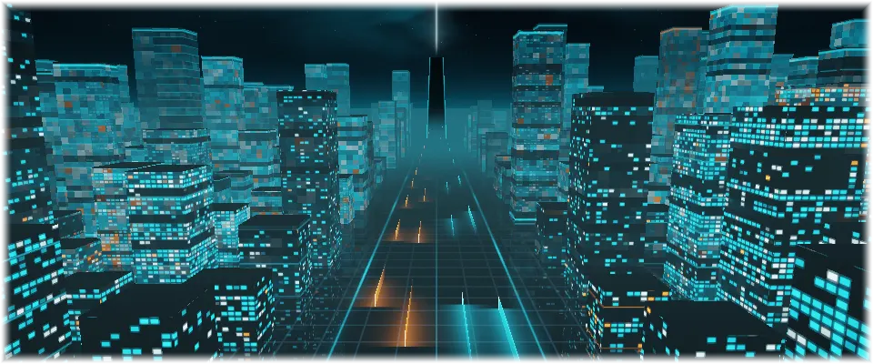
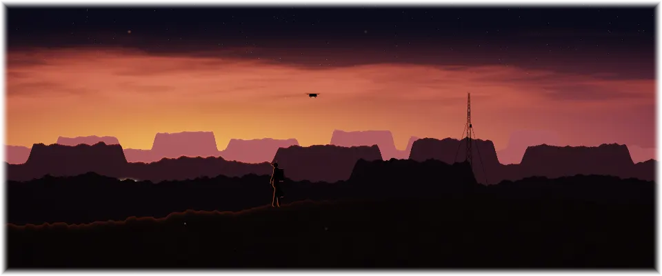

# Live wallpaper for Omarchy

Animated wallpapers for [Omarchy](https://omarchy.org) themes. When the current
wallpaper is `<theme>/backgrounds/<name>.*` and the theme has
`<theme>/live/<name>.frag.qsb`, this plugin draws that shader as the desktop.

```bash
omarchy plugin add https://github.com/Gleasonmt/omarchy-live-wallpaper --enable
```

| | |
|---|---|
|  |  |
| [**Light Grid**](https://github.com/Gleasonmt/omarchy-light-grid-theme) | [**Light Grid Towers**](https://github.com/Gleasonmt/omarchy-light-grid-towers-theme) |
|  |  |
| [**Topside**](https://github.com/Gleasonmt/omarchy-topside-theme) | [**Topside Outpost**](https://github.com/Gleasonmt/omarchy-topside-outpost-theme) |

Themes made for it:
[Light Grid](https://github.com/Gleasonmt/omarchy-light-grid-theme) ·
[Light Grid Towers](https://github.com/Gleasonmt/omarchy-light-grid-towers-theme) ·
[Topside](https://github.com/Gleasonmt/omarchy-topside-theme) ·
[Topside Outpost](https://github.com/Gleasonmt/omarchy-topside-outpost-theme)

## Lite themes

For every installed theme with a live wallpaper the plugin also makes
**<Theme> Lite** (`make-lite.sh`, at startup and every 10 minutes): the same theme,
but only small parts of the picture move (lights, beams, cloth), which costs the
least power. A theme's `live/mode.json` says which it is: `{"mode": "full"}` or
`{"mode": "details"}`.

## Settings

`~/.config/omarchy/live-wallpaper.json`:

| key | default | |
|---|---|---|
| `mode` | `theme` | plugged in: `theme` (as the theme says), `full`, `details` or `still` |
| `batteryMode` | `theme` | on battery |
| `fps` | `30` | plugged in; `0` holds a still frame |
| `batteryFps` | `10` | on battery |
| `renderScale` | `1` | when a mode is set here: share of screen resolution full motion draws at |
| `batteryRenderScale` | `0.5` | on battery, likewise |

Everything pauses while a fullscreen or near-fullscreen window covers the screen.
Measured on an Intel Iris Xe laptop on battery: full motion about +0.5 W at 10 fps
and +1.9 W at 30 fps; Lite about +0.3 W and +1.1 W.

`extras/` has an optional `live-wallpaper` command (`live-wallpaper mode details`,
`live-wallpaper battery-mode still`, ...) and an Omarchy menu entry for these
settings (Style → Live Wallpaper): copy `extras/live-wallpaper` to `~/.local/bin`
and paste the entries from `extras/omarchy-menu.jsonc` into
`~/.config/omarchy/extensions/omarchy-menu.jsonc`.

## Making a live theme

Add `live/<name>.frag.qsb` next to `backgrounds/<name>.png`: a Qt 6 fragment shader
(compile with `qsb --qt6`) with uniforms `time`, `resolution`, `viewport` and
`detail` in the standard `qt_Matrix`/`qt_Opacity` block, plus `live/<name>.json`
`{"still": <seconds>, "details": [[x0, y0, x1, y1], ...]}` listing the patches that
move in Lite. The themes above include their shader source in `src/`.
