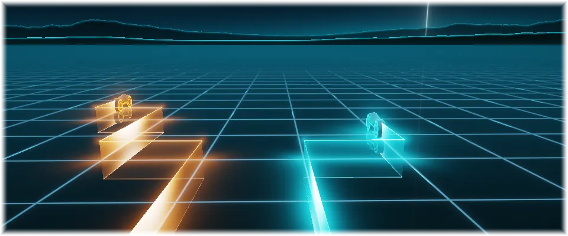
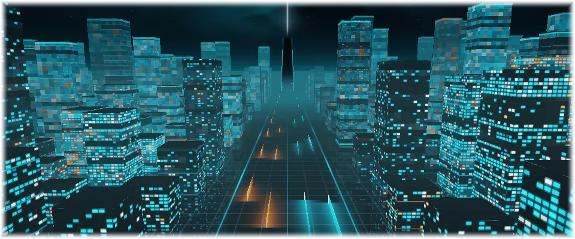
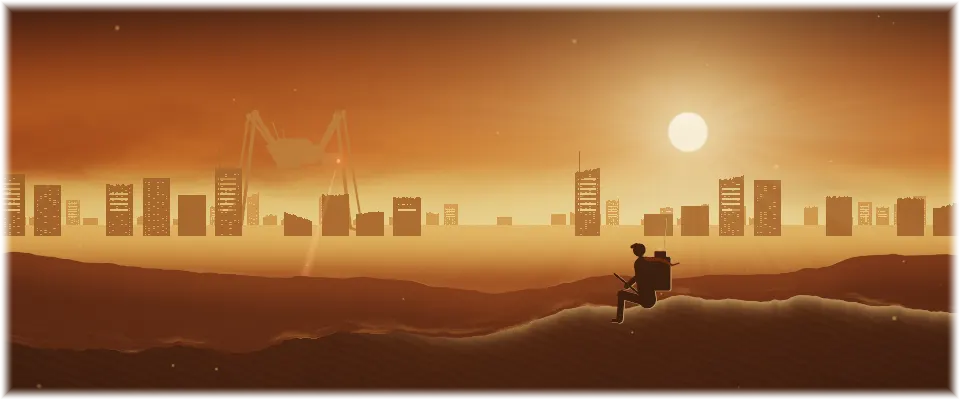
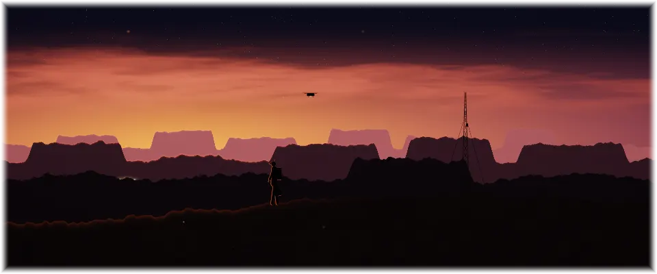
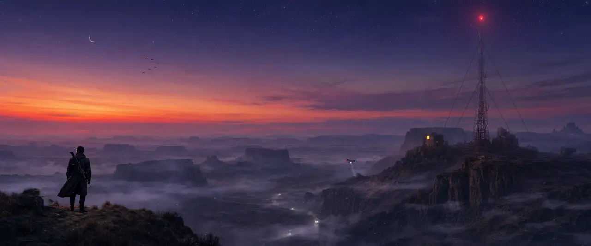

# Live wallpaper for Omarchy

Animated backgrounds for [Omarchy](https://omarchy.org) that go with any theme.
When the current background is `<pack>/backgrounds/<name>.*` and the pack has
`<pack>/live/<name>.frag.qsb`, this plugin draws that shader as the desktop.

```bash
omarchy plugin add https://github.com/Gleasonmt/omarchy-live-wallpaper --enable
```

## Live backgrounds

A live background is a small pack in `~/.config/omarchy/live-backgrounds/<pack>/`:
`backgrounds/<name>.png` (the still, also used by the lock screen) plus its `live/` folder.
Install one by cloning it there:

```bash
git clone --depth 1 https://github.com/Gleasonmt/omarchy-topside-theme ~/.config/omarchy/live-backgrounds/topside && omarchy restart shell
```

(or `live-wallpaper install <url>` with the optional command below). The plugin links
every pack into `~/.config/omarchy/backgrounds/<theme>/` for every installed theme. It does
this at startup, on each theme switch and every 10 minutes, so the scenes show up in
Omarchy menu → Style → Background whatever theme you're using. It only ever creates or
removes links into the packs folder, and a file of yours with the same name is left alone.
Remove a pack by deleting its folder (`live-wallpaper remove <pack>`); its links go with it.

| | |
|---|---|
|  |  |
| [**Light Grid**](https://github.com/Gleasonmt/omarchy-light-grid-theme) | [**Light Grid Towers**](https://github.com/Gleasonmt/omarchy-light-grid-towers-theme) |
|  |  |
| [**Topside**](https://github.com/Gleasonmt/omarchy-topside-theme) | [**Topside Outpost**](https://github.com/Gleasonmt/omarchy-topside-outpost-theme) |
|  | |
| [**Topside Mountain View**](https://github.com/Gleasonmt/omarchy-topside-mountain-view-theme) | |

Backgrounds made for it:
[Light Grid](https://github.com/Gleasonmt/omarchy-light-grid-theme) ·
[Light Grid Towers](https://github.com/Gleasonmt/omarchy-light-grid-towers-theme) ·
[Topside](https://github.com/Gleasonmt/omarchy-topside-theme) ·
[Topside Outpost](https://github.com/Gleasonmt/omarchy-topside-outpost-theme) ·
[Topside Mountain View](https://github.com/Gleasonmt/omarchy-topside-mountain-view-theme)

## Lite themes

A theme can still ship its own live wallpaper (`<theme>/live/`). For every such theme the plugin also makes
**<Theme> Lite** (`make-lite.sh`, at startup and every 10 minutes): the same theme,
but only small parts of the picture move (lights, beams, cloth), which costs the
least power. A theme's `live/mode.json` says which it is: `{"mode": "full"}` or
`{"mode": "details"}`.

## Settings

`~/.config/omarchy/live-wallpaper.json`:

| key | default | |
|---|---|---|
| `mode` | `theme` | plugged in: `theme` (as the background or theme says in its `live/mode.json`), `full`, `details` or `still` |
| `batteryMode` | `theme` | on battery |
| `fps` | `30` | plugged in; `0` holds a still frame |
| `batteryFps` | `10` | on battery |
| `renderScale` | the theme's, else `1` | plugged in: share of screen resolution full motion draws at (`0.5` is far lighter) |
| `batteryRenderScale` | `0.5` | on battery, likewise (whatever the theme says) |

Everything pauses while a fullscreen or near-fullscreen window covers the screen.
Measured on an Intel Iris Xe laptop on battery: full motion about +0.5 W at 10 fps
and +1.9 W at 30 fps; Lite about +0.3 W and +1.1 W.

`extras/` has an optional `live-wallpaper` command (`live-wallpaper mode details`,
`live-wallpaper battery-mode still`, `live-wallpaper install <url>`, `list`, `update`, `remove <pack>`, ...) and an Omarchy menu entry for these
settings (Style → Live Wallpaper): copy `extras/live-wallpaper` to `~/.local/bin`
and paste the entries from `extras/omarchy-menu.jsonc` into
`~/.config/omarchy/extensions/omarchy-menu.jsonc`.

## Making a live background

In a pack (or a theme), add `live/<name>.frag.qsb` next to `backgrounds/<name>.png`: a Qt 6 fragment shader
(compile with `qsb --qt6`) with uniforms `time`, `resolution`, `viewport` and
`detail` in the standard `qt_Matrix`/`qt_Opacity` block, plus `live/<name>.json`
`{"still": <seconds>, "details": [[x0, y0, x1, y1], ...]}` listing the patches that
move in details mode. The backgrounds above include their shader source in `src/`.

A scene can also be built from pictures and video, all from the pack's `live/`
folder, by adding to `live/<name>.json`:

| key | |
|---|---|
| `"painted": true` | the shader samples a picture as `source` (binding 1): `backgrounds/<name>.png` |
| `"plate": "<file>"` | ...or this picture instead, e.g. a copy with what the shader draws itself painted out |
| `"layers": ["a.png", ...]` | up to four more pictures, sampled as `layer1`..`layer4` (bindings 2-5): parallax layers, or parts drawn on top |
| `"video": "<file>"` | a looping video, sampled as `video` (binding 6) in full motion; paused whenever the animation is. In Lite the shader should use a picture instead |
| `"videoSize": [w, h]` | the size of the texture the video is drawn into (default `[1048, 414]`) |

Video uses Qt Multimedia (`qt6-multimedia`), which Omarchy installs.
[Topside Mountain View](https://github.com/Gleasonmt/omarchy-topside-mountain-view-theme)
is an example: four layers and a green-screen character packed as colour and mask side by side.

## Dependencies

All installed by Omarchy: Qt 6 with Qt Multimedia (`qt6-multimedia`, for video
scenes), ImageMagick (`magick`, for the LITE badge on Lite previews) and,
optionally, `inotify-tools` (`inotifywait`, to notice a wallpaper change at once
instead of within a second).

## Removing

```bash
omarchy plugin remove gleasonmt.live-wallpaper
```

That stops the animation and Omarchy's still wallpaper shows again. To also
delete the background packs and their links, the Lite themes the plugin made
(only folders carrying its marker), the settings file and the optional extras:

```bash
find ~/.config/omarchy/backgrounds -mindepth 2 -maxdepth 2 -type l -lname "$HOME/.config/omarchy/live-backgrounds/*" -delete
rm -rf ~/.config/omarchy/live-backgrounds
for d in ~/.config/omarchy/themes/*-lite; do [[ -e $d/.made-by-live-wallpaper ]] && rm -rf "$d"; done
rm -f ~/.config/omarchy/live-wallpaper.json ~/.local/bin/live-wallpaper
```

and remove the Live Wallpaper entries from
`~/.config/omarchy/extensions/omarchy-menu.jsonc` if you added them.

## License

[MIT](LICENSE)
